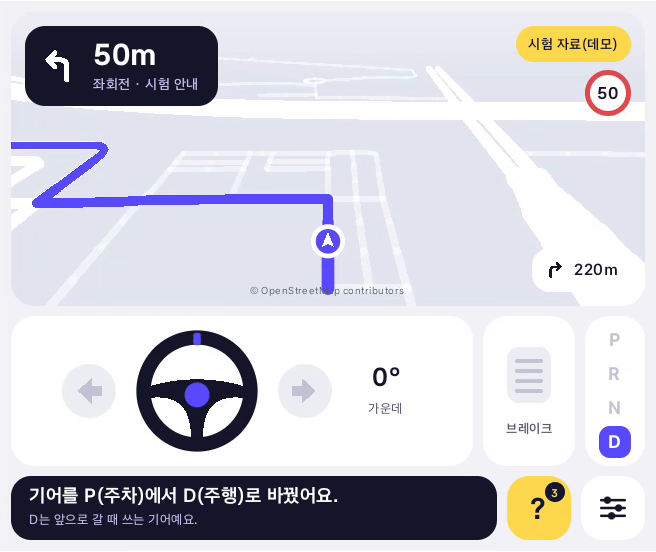
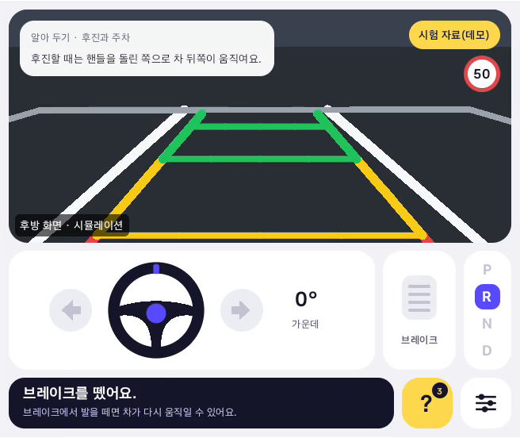
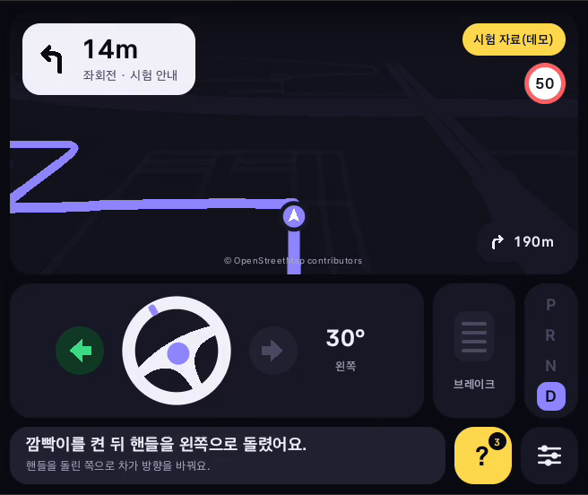
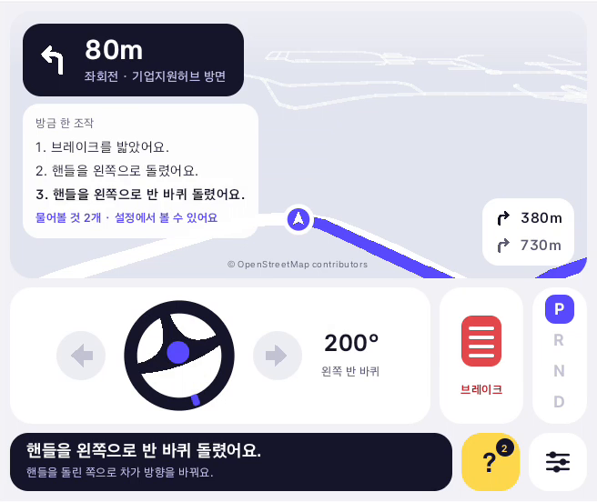
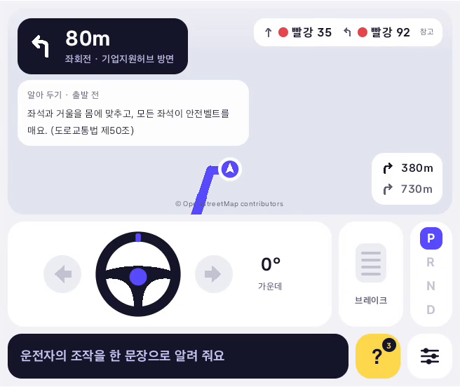
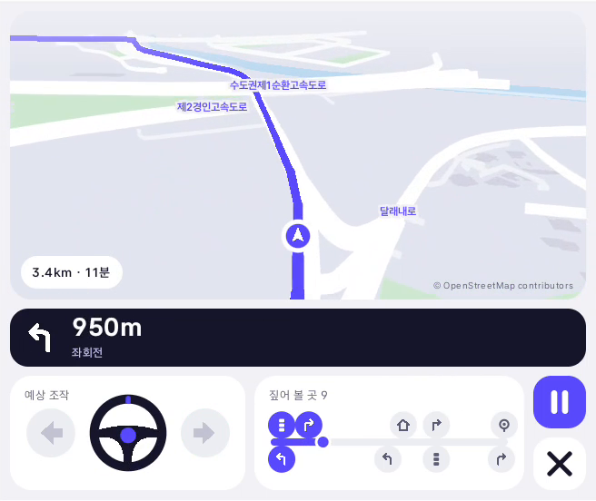

# 눈치코치 (NunchiCoach)

**옆자리에서 보고 배우는 운전.** 운전자의 핸들, 깜빡이, 브레이크, 기어를 계기판 그림으로, 가는 길을 지도와 안내 띠로 실시간으로 보여 주고, 일어난 일과 그 조작의 쓰임을 한 문장으로 해설하는 Pleos Connect 앱입니다.
면허가 없는 동승자(예비 운전자)가 운전 조작을 실제 도로 장면과 연결해 배울 수 있도록 돕습니다.
출발 전에는 **미리 가 보기**로 오늘 갈 길을 따라가며, 회전교차로나 막히는 구간처럼 미리 알아 둘 곳과 요령을 먼저 봅니다.

> 현대자동차그룹 차량용 앱 개발 공모전 출품작 (개인 참가). 이전 임시 이름은 "이세계주행천재"였고 패키지 이름(`app.passengercoach`)은 그대로입니다.

| 주행(데모) | 후진 주차(데모, 합성 후방 화면) | 야간 |
|---|---|---|
|  |  |  |

| 실제 차량 신호(기어 P) | 울산 실제 신호등(참고용) | 미리 가 보기(출발 전) |
|---|---|---|
|  |  |  |

## 한눈에 보기
| 화면 요소 | 데이터 출처 |
|---|---|
| 계기판: 핸들 각도, 방향지시등, 브레이크, 기어 | Pleos Vehicle SDK `SteeringWheel`, `TurnSignal`, `Brake`, `Gear` |
| 전조등, 상향등, 와이퍼, 운전석 안전벨트, 문 | Vehicle SDK `Light`, `Wiper`, `Safety`, `Door` |
| 다음 안내와 안내 띠, 제한속도, 단속 카메라, 주의 지점 | Pleos NaviHelper SDK (TBT, 제한속도, 카메라, 주의 지점) |
| 지도의 길 모양, 미리 가 보기의 건물·녹지·하천·이름·길 위의 시설 | OpenStreetMap(Overpass API). 앱이 직접 그립니다 |
| 지도의 경로 선 | 카카오모빌리티 길찾기 API로 **따로 계산**(내비의 길과 다를 수 있음) |
| 미리 가 보기의 짚어 볼 곳, 막히는 구간 | 같은 길찾기 API 응답의 안내 지점 종류와 구간별 혼잡도 |
| 신호등 잔여시간(참고용) | 공공데이터포털 교차로 신호등 실시간 정보 |
| 해설 한 문장 + 조작의 쓰임 한 줄, 알아 두기, 되짚기 | 위 신호를 조합한 규칙(`CoachEngine` 등) |

- **읽기 전용**입니다. 차량을 제어하지 않습니다.
- **운전자 화면에는 표시되지 않습니다.** 주행 최적화(DO)를 선언하지 않아 센터 화면에서는 **기어 D에서 시스템이 앱을 차단**합니다(속도 0에서도 차단되는 것을 에뮬레이터에서 확인). **동승자 전용 화면을 전제로 한 설계**이며, Pleos Connect 공식 문서에 동승석 창이 있으나 주행 중 사용 제한의 예외인지는 확인하지 못했습니다. 센터 화면에서는 주차 상태의 실제 신호와 데모 모드로 확인할 수 있습니다.
- **운전자의 조작 데이터는 기기 밖으로 보내지 않습니다.** 지도와 길을 그리기 위해 현재 위치, 목적지와 그 사이 경로만 외부 서비스로 보내며, 동의 화면에 밝힙니다. 학습 기록과 "물어볼 것"은 기기 안에만 저장합니다.
- 첫 실행에서 동의하기 전에는 차량 신호를 읽지 않습니다. **운전자 동의 체크**를 따로 받고, 동의는 설정에서 **철회**할 수 있습니다(철회하면 기록과 설정 삭제).
- 점수나 평가를 하지 않고, 일어난 일과 조작의 쓰임만 말합니다.

## 기능
| 기능 | 설명 |
|---|---|
| 계기판 | 각도만큼 돌아가는 핸들, 깜빡이는 방향지시등, 브레이크, 기어를 그림으로 표시. 글자는 해설 한 줄만 |
| 지도와 경로 선 | 진행 방향이 위로 가는 지도(건물, 녹지, 하천, 길과 건물 이름, 신호등 포함), 경로 선, 다음 안내(화살표와 남은 거리)와 그다음 안내 2개 |
| 미리 가 보기 | 출발 전에 오늘 갈 길(내비 목적지까지)을 주행 화면과 같은 모습으로 빠르게 따라감. 회전, 유턴, 회전교차로, 고가도로, 지하차도, 합류, 요금소, 지금 막히는 구간에서 느려지며 요령 한 줄과 **예상 조작**(깜빡이, 핸들)을 보여 줌. 과속방지턱, 단속 카메라, 학교 앞도 짚음. 요령은 지도 바로 아래 안내 칸에 나오며(지도를 가리지 않음), 기본 규칙이 아니라 실전 요령(내륜차, 사이드미러 기준, 가속 차로 등)과 연달아 나오는 회전의 차로 잡는 법을 알려 줌. 지도에 건물, 녹지, 하천, 이름, 신호등 표시. 막히는 구간에서는 차로 변경 순서 그림. 짚어 볼 곳 그림을 누르면 그 앞으로 건너뜀. 목적지나 인증키가 없으면 앱에 넣어 둔 연습 코스(약 5km, 시험 자료) |
| 표지판 | 제한속도, 단속 카메라, 주의 지점(어린이 보호구역 등)을 표지판과 필기시험 용어로 표시 |
| 코치 해설 | 일어난 일 한 문장 + 그 조작의 요령 한 줄(예: "미리 가볍게 밟고, 멈추기 직전에 살짝 풀면 몸이 앞으로 쏠리지 않아요"). 8초 뒤 흐려지고 30초 뒤 지워짐 |
| 주차(후진) | 합성 후방 화면(핸들 각도로 계산한 가이드선, **시뮬레이션이며 실제 카메라 영상 아님**)과 조작 순서 해설 |
| 물어볼 것 | 궁금한 순간에 한 번 누르면 저장, 주차한 뒤 목록으로 확인 |
| 되짚기와 알아 두기 | 멈췄을 때 방금 한 조작 3개. 해설이 없을 때는 해설 칸에 상황에 맞는 실전 요령 한 줄(지도를 가리지 않음) |
| 신호등 잔여시간(참고용) | 300m 안에 실시간 신호가 있는 교차로가 있으면 직진과 좌회전 신호의 색과 남은 초 |
| 추가 조작 신호 | 전조등, 상향등, 와이퍼, 운전석 안전벨트, 문 열림의 해설 |
| 설정 | 연습 상황 선택, 코치 모드, 학습 기록, 물어볼 것 보기, 글자 위주의 이전 화면, 동의 철회 |
| 처음 쓰는 사람용 안내 | 첫 실행 때 화면의 각 부분과 버튼을 한 장씩 설명. 설정에서 다시 볼 수 있음 |
| 실패 처리 | 연결하는 중, 차량 신호 없음과 다시 시도, 내비 안내 없음 |
| 야간 화면 | 차량의 야간 모드를 따라 어두운 화면 |
| 데모 모드 | 차량 없이 좌회전, 작은 핸들 조작, 신호 대기, 후진 주차를 반복 재생 |

## APK
- 위치: [`apk/InfinityNBeyond_눈치코치_release.apk`](apk/) (release 빌드, 서명됨)
- 패키지 이름: `app.passengercoach`, 버전 0.1.0
- **이 APK에는 길찾기와 신호등 인증키가 없습니다.** 그래서 지도의 경로 선과 신호등 잔여시간은 꺼져 있고, 미리 가 보기는 앱에 넣어 둔 **연습 코스(약 5km, 지도 자료 포함, 시험 자료)** 로 동작합니다. 나머지(계기판, 지도의 길과 내비 안내, 해설, 데모)는 그대로 동작합니다. 데모 모드에서는 경로 선과 신호등 장면이 시험 자료로 나옵니다.

## 실행 방법 (Pleos Connect 에뮬레이터)
1. Android Studio와 Pleos Connect 에뮬레이터를 설치하고 실행합니다(공식 가이드: Pleos Playground 개발 환경 설정).
2. APK를 설치합니다.
   ```
   adb install -r apk/InfinityNBeyond_눈치코치_release.apk
   ```
3. 앱을 실행하고 첫 화면에서 **운전자 동의**에 체크한 뒤 **동의하고 시작**을 누릅니다. 이어서 나오는 사용법 안내는 **건너뛰기**로 넘길 수 있습니다.
4. Virtual Console(`adb forward tcp:8088 tcp:8088` 후 `http://127.0.0.1:8088/`)에서 핸들, 브레이크, 방향지시등, 전조등, 와이퍼, 문 값을 바꾸면 화면이 따라 바뀝니다. **기어를 D에 넣으면 센터 화면에서는 앱이 차단되므로**, 실제 신호는 기어 P에서 확인합니다.
5. 내비 안내는 에뮬레이터의 내비 앱에서 목적지를 설정해 경로가 있을 때 표시됩니다.
6. **데모(시험 자료) 모드**: 주행 화면 오른쪽의 **기어 칸(P R N D)을 5번** 누르면 켜지고 다시 5번 누르면 꺼집니다. 화면에 "시험 자료(데모)"가 표시됩니다.
7. **미리 가 보기**: 기어 칸 오른쪽의 보라색 버튼(길과 핀 그림)을 누릅니다. 오른쪽 버튼으로 멈춤과 계속, 짚어 볼 곳 그림을 누르면 건너뛰기, X로 닫습니다.
8. 보라색 버튼 아래의 **설정** 버튼에서 연습 상황, 코치 모드, 학습 기록, 물어볼 것, 이전 화면, 동의 철회를 쓸 수 있습니다.
9. 야간 화면은 `adb shell cmd uimode night yes`(끄기: `no`)로 확인할 수 있습니다.

## 테스트 환경
| 항목 | 값 |
|---|---|
| Pleos Connect Emulator | **v2.1.0** (이미지 API 34, Android 14) |
| 화면 규격 | **1024 x 768, 160dpi** 가로 (AVD `automotive_1024p_landscape`, RAM 4GB, Cold boot) |
| Vehicle SDK | `ai.pleos.playground:Vehicle:2.3.2` |
| NaviHelper SDK | `ai.pleos.playground:NaviHelper:3.0.5` |
| 빌드 | JDK 17, Gradle 8.10.2, Android Gradle Plugin 8.8.2, Kotlin 2.0.0, compileSdk 35, minSdk 28 |
| 호스트 | Windows 11 |

## 빌드
```
./gradlew testDebugUnitTest      # 단위 테스트 64개
./gradlew assembleDebug          # debug APK (개발용: 경로 요청 권한, 인증키 포함)
./gradlew assembleRelease        # release APK (인증키 없음. 서명 정보는 환경 변수 COACH_KEYSTORE_PROPS가 가리키는 파일에서 읽음)
```
- Pleos SDK는 `https://nexus-playground.pleos.ai/repository/maven-releases/` 저장소에서 가져옵니다(인증 불필요).
- **외부 데이터 기능을 켜려면** `local.properties`(저장소에 올라가지 않음)에 아래 키를 넣고 debug 빌드를 합니다.
  - `ROUTE_API_KEY=...` : 카카오디벨로퍼스의 REST API 키(지도의 경로 선, 미리 가 보기의 실제 길)
  - `SIGNAL_API_KEY=...` : 공공데이터포털 "교차로 신호등 실시간 정보" 인증키(Encoding)
- 검증용 명령(debug 빌드):
  - 경로 요청(미리 가 보기의 목적지도 이것으로 정해짐): `adb shell am broadcast -a app.passengercoach.DEBUG_ROUTE --ed lat 37.3947 --ed lon 127.1112`
  - 위치 지정(신호등 확인용, 울산): `adb shell am broadcast -a app.passengercoach.DEBUG_LOCATION --ed lat 35.512239 --ed lon 129.430952 --ed heading 0`

## 구조
```
app/src/main/java/app/passengercoach/
  signal/SignalHub.kt        Vehicle SDK 신호 구독
  signal/NaviHub.kt          NaviHelper 안내, 위치, 목적지, 표지판 구독
  signal/RoadHub.kt          주변 길 모양 받기(OpenStreetMap)
  signal/RouteHub.kt         지도 경로 선 계산(카카오모빌리티)
  signal/TrafficLightHub.kt  신호등 공공데이터 받기
  coach/                     판단 로직(Android와 SDK에 의존하지 않음, 단위 테스트 대상)
    CoachEngine.kt 해설과 주차 / Tips.kt 상황과 알아 두기 / DriveState.kt 상태 / Recap.kt 되짚기
    Preview.kt 미리 가 보기 / MapMath.kt 지도 좌표 / RouteMath.kt 경로 / RearMath.kt 후방 화면 / TrafficLights.kt 신호 / RoadSigns.kt 표지판 / RecordStore.kt 기록
  demo/                      데모(시험 자료) 재생과 데모 경로
  ui/Cockpit.kt              새 주행 화면(계기판, 안내, 표지판)
  ui/MapPanel.kt             앱이 직접 그리는 지도
  ui/RearView.kt             합성 후방 화면
  ui/PreviewScreen.kt        미리 가 보기 화면
  ui/CoachScreen.kt          동의, 설정, 기록, 이전 화면
docs/                        요구서, 화면 흐름, 기술 검증, QA 결과
```

## 확인한 것과 한계
- 확인 결과는 [`docs/qa.md`](docs/qa.md)에 있습니다. 에뮬레이터에서 신호 수신 지연은 약 0.2초 이하로 측정했습니다(시계 오차 ±0.1초 포함).
- Vehicle SDK 2.3.2에는 **속도, 가속페달, 시동 상태, 주변 차량 경고, 후방 카메라, 주차 센서 API가 없습니다.** NaviHelper는 **지도 화면과 경로 좌표를 주지 않습니다.** 그래서 지도는 앱이 직접 그리고 경로 선은 따로 계산하며, 후방 화면은 핸들 각도로 계산한 시뮬레이션입니다(핸들 비율 15:1, 축 거리 2.9m 가정).
- 실차 검증과 해설·알아 두기 문구의 전문가 검수는 하지 않았습니다. 법령 인용 문구는 초안입니다.
- 핸들 각도 기준(조금 6도, 돌림 20도, 반 바퀴 180도)과 내비 거리 기준(300m)은 실차 데이터 없이 정한 값입니다. 그래서 작은 핸들 조작을 "차선 변경"이라고 단정하지 않습니다.
- 에뮬레이터의 한계: 목적지 좌표가 0으로 옵니다(경로 선은 개발용 목적지로 확인). 안전벨트 경고와 "지원하지 않는 신호" 상황은 만들 수 없었습니다. 화면 크기는 1024x768 한 가지로만 확인했습니다.
- 신호등 실시간 값은 2026-11-15 기준 울산 399개 교차로만 들어왔고, 방향 칸이 접근로 방위라는 것은 가정입니다. 제공 기관이 참고용이라고 고지했습니다.
- 길 모양을 주는 공용 서버(Overpass)는 느리거나 실패할 때가 있어, 받은 자리는 기기에 저장해 다시 씁니다(2026-11-15 낮에는 네 곳 중 한 곳만 응답). 출시하려면 사용 조건에 맞는 지도 자료 서비스가 필요합니다.
- 미리 가 보기: 길은 따로 계산한 것이라 운전자 내비의 길과 다를 수 있습니다. **다른 차의 움직임(끼어들기)은 알 수 없어** 일반 요령과 설명용 그림으로만 안내하고, 그 교차로가 비보호인지와 차로 수도 알 수 없습니다. 예상 조작은 길 모양으로 어림한 그림입니다. 과속방지턱과 단속 카메라는 OpenStreetMap에 등록된 곳만 나옵니다. 건물까지 받는 데 10~45초가 걸려 지형은 길보다 늦게 나타납니다. 카카오맵 화면 SDK는 에뮬레이터(x86_64)에서 쓸 수 없어 지도를 직접 그렸습니다. 20km가 넘는 긴 경로는 지도의 길이 중간중간 비어 보일 수 있습니다.
- 운전자 동의는 체크로 받지만 누가 눌렀는지 앱이 확인할 수는 없습니다.
- 자세한 근거는 [`docs/기술검증_2026-11-13.md`](docs/기술검증_2026-11-13.md)를 참고하세요.

## 라이선스와 고지
- 이 저장소에는 Pleos SDK, 에뮬레이터 이미지, 공식 샘플 앱 코드를 포함하지 않습니다(42dot SDK 라이선스에 따라 재배포하지 않음).
- 지도의 길 모양, 데모 경로, 미리 가 보기 연습 코스와 그 지도 자료(`assets/preview_*.json`)는 © OpenStreetMap contributors 자료입니다(ODbL).
- "현대", "Pleos", "카카오"는 각 권리자의 상표이며, 이 앱은 공모전 출품작으로 공식 서비스가 아닙니다.